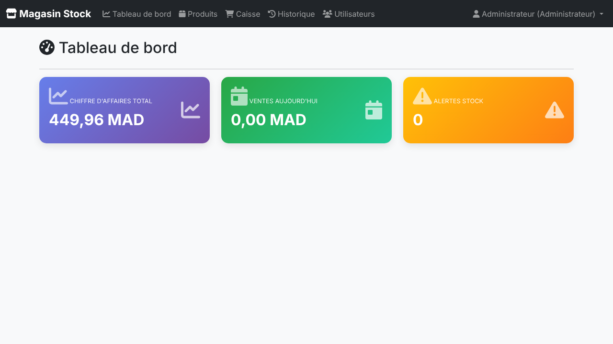
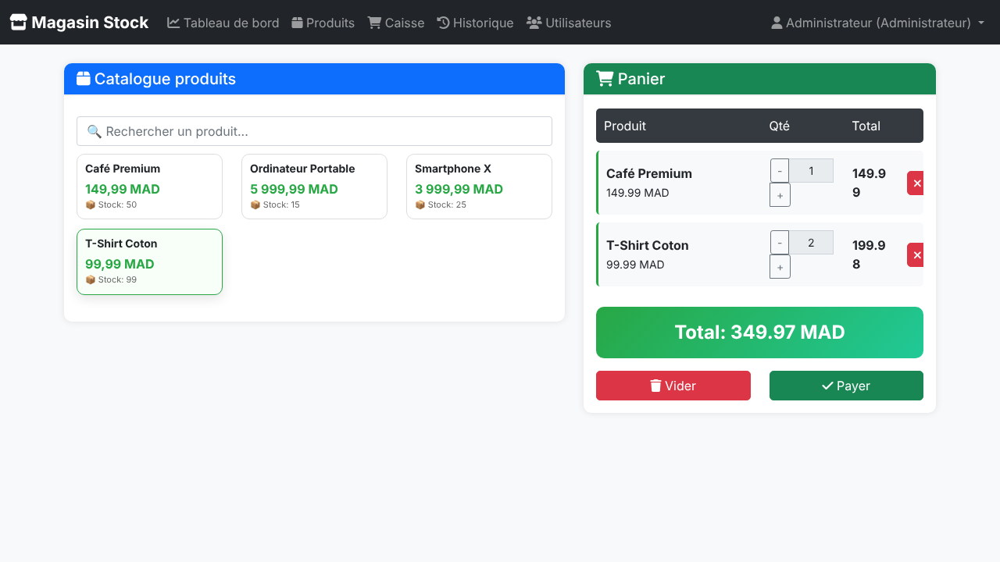
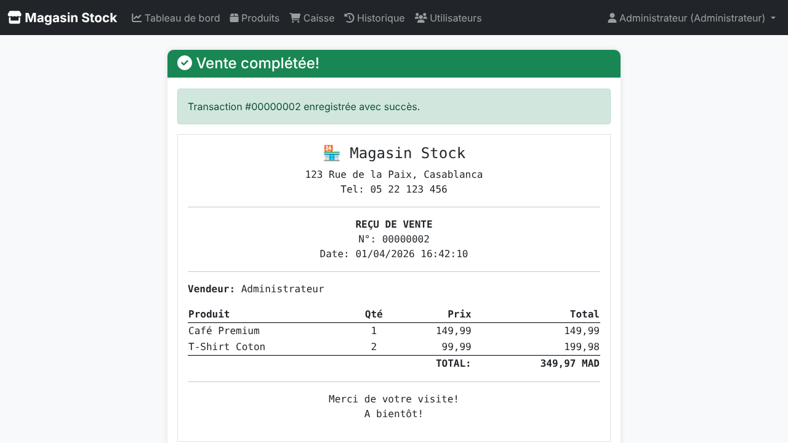
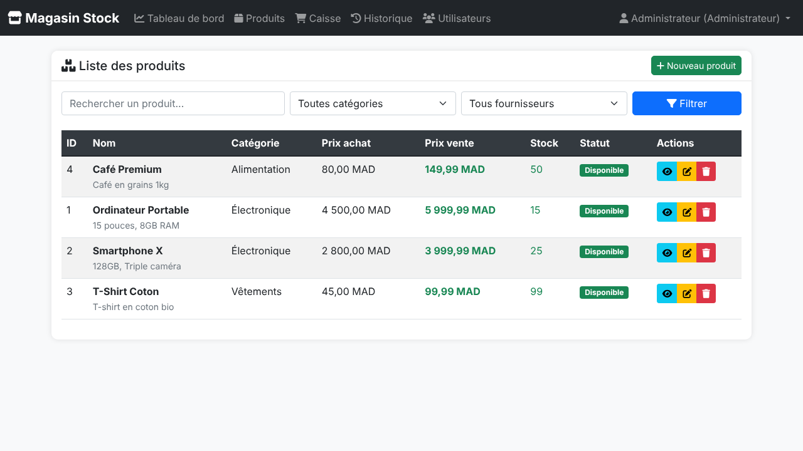
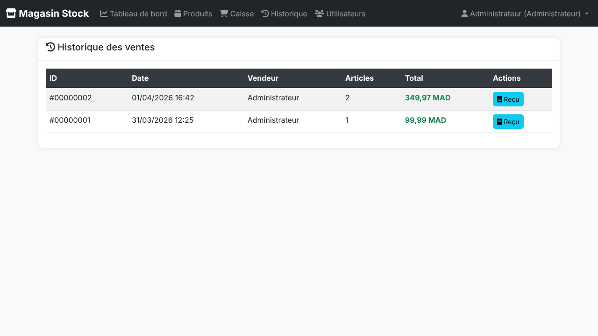
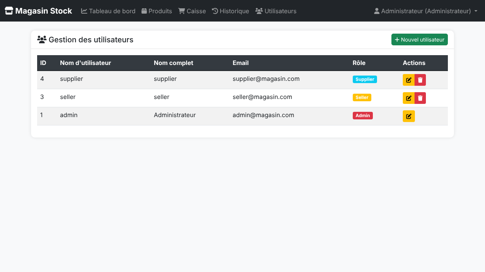

# OptiStock — Stock & Sales Management (PHP / MySQL)

Web application for a small shop: product catalogue, stock alerts, point of sale (POS), printable receipts, sales history and user management with roles.
Built with plain PHP following an **MVC architecture** (no framework) — Université Internationale de Rabat (April 2026).



## Features

| Role | Access |
|---|---|
| **Admin** | Dashboard (revenue, today's sales, stock alerts), products CRUD, POS, sales history, user management |
| **Seller** | Dashboard, product list, POS, sales history |
| **Supplier** | Their own products and stock alerts |

- **Products:** name, category, supplier, purchase/selling price, quantity, alert threshold; search and filters by category and supplier
- **Point of sale:** click products to build a cart, adjust quantities, pay → stock is updated automatically
- **Receipts:** printable receipt for every sale
- **Stock alerts:** products under their alert threshold are listed separately

| Point of sale | Receipt |
|---|---|
|  |  |

| Products | Sales history | Users |
|---|---|---|
|  |  |  |

## Architecture

```
index.php                 Front controller / router (?controller=…&action=…)
config/database.php       PDO connection
controllers/              Auth, Dashboard, Product, Sale, User (+ base Controller: render, auth, roles)
models/                   Product, Sale, User, Category, Supplier (PDO prepared statements)
views/                    Layout + pages (Bootstrap 5)
public/                   CSS / JS
database/magasin_stock.sql  Schema + sample data
```

## Security

- Passwords hashed with `password_hash` / `password_verify` (bcrypt)
- All SQL queries use PDO prepared statements
- Output escaped with `htmlspecialchars`
- Role checks on every protected action (`requireAuth`, `requireRole`)
- Sales are validated server-side: prices are taken from the database and quantities checked against stock (the browser cannot change a price)

## Run it

**With XAMPP (Windows):**
1. Copy the project folder into `C:\xampp\htdocs\optistock`
2. Start Apache and MySQL, open phpMyAdmin and import `database/magasin_stock.sql` into a new database named `magasin_stock`
3. Open `http://localhost/optistock`

**With PHP's built-in server:**
```bash
mysql -u root -e "CREATE DATABASE magasin_stock"
mysql -u root magasin_stock < database/magasin_stock.sql
php -S localhost:8000
```
Then open `http://localhost:8000`.

DB credentials are in `config/database.php` (default: `root` with an empty password).

Sample accounts:

| Role | Username | Password |
|---|---|---|
| Admin | `admin` | `1234` |
| Seller | `seller` | `1234` |
| Supplier | `supplier` | `1234` |

## Tech stack

PHP 8 · MySQL / MariaDB · PDO · Bootstrap 5 · Font Awesome · JavaScript (Fetch API)

## Author

**Riyad Nouar**
